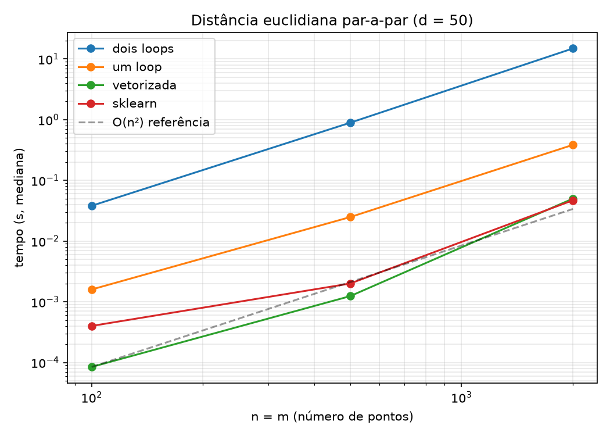

# ml-from-scratch

Algoritmos de Machine Learning implementados do zero em NumPy, com API no estilo
scikit-learn (`fit`, `predict`, `predict_proba`), e comparados com as bibliotecas
de referência (scikit-learn e, mais tarde, PyTorch).

A ideia não é substituir as bibliotecas, e sim entender o que elas fazem por dentro.
Toda implementação é comparada em quatro pontos:

1. **Paridade:** com os mesmos hiperparâmetros, os resultados batem (`np.allclose`)?
2. **Métricas:** mesmo split e mesma seed para as duas versões.
3. **Escalabilidade:** tempo de execução com n crescendo, em gráfico log-log.
4. **Diferenças de implementação:** o que a biblioteca faz que a minha versão não faz.

## Progresso

| Fase | Tema | Status |
| --- | --- | --- |
| 1 | NumPy para ML + infraestrutura de avaliação | Em andamento |
| 2 | Modelos lineares + fluxo completo de projeto | Não iniciada |
| 3 | KNN, Naive Bayes, árvores | Não iniciada |
| 4 | Ensembles e SVM | Não iniciada |
| 5 | Não supervisionado | Não iniciada |
| 6 | Problemas do mundo real + projeto principal | Não iniciada |
| 7 | Fundamentos de DL: do zero → PyTorch | Não iniciada |
| 8 | CNNs, RNNs/LSTMs, Transformers | Não iniciada |

### Fase 1: pacote `mlscratch` v0.1

- [x] Distâncias euclidianas par-a-par (dois loops, um loop, vetorizada) + testes + benchmark
- [ ] Funções numericamente estáveis (softmax, log-sum-exp, sigmoid)
- [ ] Pré-processamento (`StandardScaler`, `MinMaxScaler`, `OneHotEncoder`)
- [ ] Divisão de dados (`train_test_split`, `KFold`, `StratifiedKFold`)
- [ ] Métricas de regressão e classificação (incluindo log loss e ROC-AUC)

## Instalação

Requer Python 3.11+.

```bash
git clone https://github.com/Vinims30/ml-from-scratch.git
cd ml-from-scratch
python -m venv .venv
source .venv/bin/activate        # fish: source .venv/bin/activate.fish
pip install -e ".[dev]"
```

O `pip install -e` instala o pacote em modo editável: alterações em `mlscratch/`
valem na hora, nos notebooks e nos testes, sem reinstalar.

## Uso

```python
import numpy as np
from mlscratch.utils.distances import euclidean_vectorized

A = np.array([[0.0, 0.0], [1.0, 1.0]])
B = np.array([[3.0, 4.0]])
euclidean_vectorized(A, B)
# array([[5.        ],
#        [3.60555128]])
```

## Testes

```bash
pytest -v
```

Os testes comparam cada implementação com a do scikit-learn. Veja [tests/README.md](tests/README.md).

## Resultados

### Distância euclidiana par-a-par (n = m = 2000, d = 50)

| Implementação | Tempo (mediana) | Speedup vs. dois loops |
| --- | --- | --- |
| Dois loops | ~14,7 s | 1× |
| Um loop | ~380 ms | ~39× |
| Vetorizada | ~43 ms | ~340× |
| scikit-learn | ~38 ms | ~385× |



Detalhes e conclusões em [notebooks/fase1/06_benchmark_distancias.ipynb](notebooks/fase1/06_benchmark_distancias.ipynb).

## Estrutura

```text
ml-from-scratch/
├── mlscratch/          # o pacote: implementações do zero
│   └── utils/          # distances, numerics, preprocessing, model_selection, metrics
├── tests/              # paridade com o scikit-learn (pytest)
├── benchmarks/         # harness de tempo e figuras geradas
├── notebooks/          # exercícios e benchmarks, organizados por fase
└── docs/comparisons/   # um relatório por algoritmo (a partir da Fase 2)
```

Cada pasta tem seu próprio README explicando o conteúdo.
